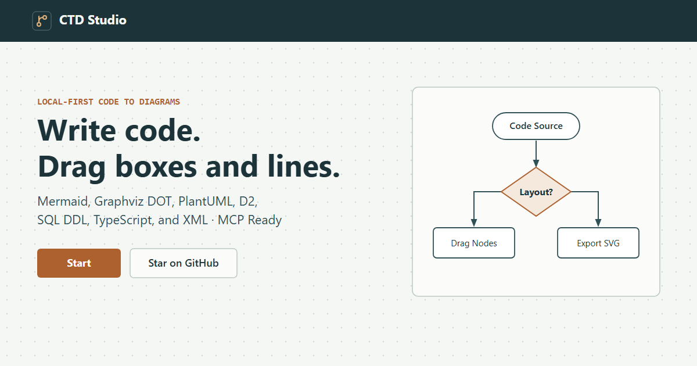

# CTD Studio

[](https://github.com/cxernlol/code-to-diagram/actions/workflows/ci.yml)
[](https://www.npmjs.com/package/ctd-mcp)
[](LICENSE)

> **v1.3.0** — Write diagram code, drag boxes into shape, export PNG/SVG or commit `*.ctd.json` layouts. No account, no server. *(Note: the npm badge reflects the latest published `ctd-mcp` release if the registry has not yet been updated to repo `1.3.0`.)*

- **Casual & Students:** Open the app, click **Start drawing**, drag boxes, and **Download PNG** — starts in Simple mode with zero setup.
- **Developers & Agents:** Keep diagram source (`*.mmd`) clean in git, store manual positions in `*.ctd.json` sidecars, and wire **`ctd-mcp`** into Cursor, Claude, Windsurf, or VS Code.

**[Open the app ->](https://code-to-diagram.vercel.app/)** · **[Quick-start simple mode ->](https://code-to-diagram.vercel.app/?mode=quick)** · **[Docs & 5-min tutorial ->](https://code-to-diagram.vercel.app/docs)**



## Contents

- [What’s New in v1.3](#whats-new-in-v13)
- [Who It’s For](#who-its-for)
- [Export & Git Layout (`*.ctd.json`)](#export--git-layout-ctdjson)
- [Supported Syntax (7 Formats)](#supported-syntax-7-formats)
- [CTD Studio MCP Server (`ctd-mcp`)](#ctd-studio-mcp-server-ctd-mcp)
- [Optional Power Features](#optional-power-features)
- [Develop & Test Locally](#develop--test-locally)
- [Data, Security & Links](#data-security--links)
- [License](#license)

## What’s New in v1.3

- **Portable `*.ctd.json` sidecar layouts (v1):** Save manual node coordinates and 3-point edge handles separately from diagram source via [schema/ctd-sidecar.v1.json](https://code-to-diagram.vercel.app/schema/ctd-sidecar.v1.json).
- **Beginner-first Studio UX:** Reversible **Simple mode** on first visit (`Studio menu → More tools` to reveal developer tools), **PNG-first topbar** (`Download PNG`, `Copy share link`, `More export…`), and one-click `?mode=quick` / `?simple=1` entry URLs.
- **Canonical `/docs` & 5-minute tutorial:** Interactive lessons, syntax/format search, coursework vs. project onboarding lanes, and [docs/FIRST_TIME_CODE_TO_DIAGRAM.md](docs/FIRST_TIME_CODE_TO_DIAGRAM.md).
- **Golden samples & headless render:** One-click `git-flow` sample on Home and in-app (`public/samples/git-flow/`), plus headless SVG/PNG CLI rendering (`scripts/render-diagram.mjs`).
- **Expanded `ctd-mcp` verification:** Added `verify_against_files` and `preview_patch` alongside layout-preserving regeneration and SHA-256 drift checks.

## Who It’s For

- **Coursework & Quick Diagrams:** Start from **Flowchart**, **Loop Trace**, or **SQL Schema**, tweak labels, drag nodes (`V`), and export a crisp PNG or submission bundle.
- **Engineering Docs in Git:** Review clean `.mmd` diffs in PRs while preserving hand-tuned positions in `.ctd.json` sidecars.
- **AI Coding Assistants:** Generate, translate, patch, and verify diagrams against SQL/TypeScript files over MCP stdio.

## Export & Git Layout (`*.ctd.json`)

- **PNG-first:** Click **Download PNG** in the topbar for slides and assignments.
- **More export…:** Export full-bounds **SVG**, **Copy source**, **Export layout (`.ctd.json`)**, or **Submission export** (`PNG + .<ext> + .ctd.json`).
- **Share links (`#d=`):** **Copy share link** encodes diagram source and manual layout into the URL hash—never API keys.
- **Git & Sidecar Workflow:** See [docs/GIT_AND_AGENT_WORKFLOW.md](docs/GIT_AND_AGENT_WORKFLOW.md), the live schema at [ctd-sidecar.v1.json](https://code-to-diagram.vercel.app/schema/ctd-sidecar.v1.json), and sample fixtures in [`tests/fixtures/git-flow/`](tests/fixtures/git-flow/) and [`public/samples/git-flow/`](public/samples/git-flow/).

## Supported Syntax (7 Formats)

All 7 formats are auto-detected and can be converted to Mermaid or translated across formats via the shared intermediate representation (`src/lib/formats.ts` and `src/lib/translate.ts`). Non-Mermaid formats support focused, practical subsets:

| Format | Extension | What is parsed & rendered | Notable omissions |
| :--- | :--- | :--- | :--- |
| **Mermaid** | `.mmd` | **Full Mermaid v12.3.0** for rendering. IR translation supports `flowchart`/`graph`, `classDiagram`, `erDiagram`, and `sequenceDiagram`. | Other Mermaid types (`gantt`, `pie`, `mindmap`, `gitGraph`, `C4*`, etc.) render natively without IR translation. |
| **Graphviz DOT** | `.dot` | `(strict) (di)graph`, `rankdir`, `subgraph`, node `label` & `shape`, chained `->` / `--` edges with `label` & `style=dashed\|dotted`. | Default `node`/`edge`/`graph` attribute statements, HTML-like labels, and `record` port layouts. |
| **PlantUML** | `.puml` | `@startuml` blocks: **sequence**, **state**, **activity**, and **class** (`class`/`interface`/`enum`/`abstract class`, multiplicity, relations). | Component, deployment, and use-case diagrams; `alt`/`loop` fragments, `package` nesting, `skinparam`. |
| **D2** | `.d2` | `direction`, nested `{ ... }` containers (`subgraph`), `id: label`, `id.shape`, edges (`->`, `<-`, `<->`, `--`) with labels. | `sql_table` / `class` shape blocks, `style` rules, `icon`, `link`, `near`, `grid-*`, `vars`/`layers`. |
| **SQL DDL** | `.sql` | `CREATE TABLE [IF NOT EXISTS]` into `erDiagram` entities: columns, `PRIMARY KEY`, inline `REFERENCES`, table-level `FOREIGN KEY`. | `ALTER TABLE`, views, indexes, `ENUM`s, triggers/functions, `CHECK`/`UNIQUE` details. |
| **TypeScript** | `.ts` | `[export] interface`, `class`, and object `type Name = { ... }` declarations; `extends`/`implements`, property type references. | Generic type parameters (`<T>`), non-object `type` aliases, `enum`s, functions, imports. |
| **XML** | `.xml` | **Draw.io / mxGraph**, **BPMN 2.0**, explicit `<diagram>`/`<graph>`/`<schema>`, and **generic XML** trees. | Draw.io custom styles beyond shapes/dashed edges; BPMN pools/lanes; XSD validation. |

## CTD Studio MCP Server (`ctd-mcp`)

`ctd-mcp` ([`mcp/README.md`](mcp/README.md)) is the bundled MCP server reusing the same parsers, IR translators, and sidecar helpers. Use it in **Claude Desktop**, **Cursor**, **Windsurf**, **VS Code**, or **Claude Code**:

```bash
npx -y ctd-mcp
```

<details>
<summary>Client configuration (Claude Desktop / Cursor / Windsurf / VS Code)</summary>

**Claude Desktop / Cursor / Windsurf** (`claude_desktop_config.json`, `.cursor/mcp.json`, or `mcp_config.json`):

```json
{
  "mcpServers": {
    "ctd-mcp": {
      "command": "npx",
      "args": ["-y", "ctd-mcp"]
    }
  }
}
```

**VS Code** (`.vscode/mcp.json`):

```json
{
  "servers": {
    "ctd-mcp": {
      "type": "stdio",
      "command": "npx",
      "args": ["-y", "ctd-mcp"]
    }
  }
}
```

</details>

### Available MCP Tools, Resources & Prompts

- **Core & Translation Tools:** `detect_format`, `to_mermaid`, `translate_format`, `parse_diagram_ir`, `emit_from_ir`, `list_templates`, `get_studio_info`, `configure_mermaid_diagram`
- **Layout, Verification & Patch Tools:** `regen_preserve_layout`, `list_orphan_layout`, `diff_ir`, `verify_diagram`, `verify_against_files`, `patch_source`, `preview_patch`, `check_drift`
- **Resources & Prompts:** `ctd://formats`, `ctd://themes`, `ctd://templates/{name}`, `code_to_diagram`, `configure_diagram`, `explain_diagram`
- **MCP Safety:** `ctd-mcp` runs in-memory over stdio with **no network calls** (only `verify_against_files` reads a local `filePath` when explicitly provided; all other tools operate purely in-memory).

## Optional Power Features

Hidden behind **Studio menu → More tools** in Simple mode so first-time users stay focused:

- **BYOK AI Refinement:** Connect your own key for 14 providers (OpenAI, Anthropic, Google Gemini, DeepSeek, OpenRouter, Groq, xAI, Mistral, Together, Fireworks, Ollama, LM Studio, Anthropic-compatible, or custom). Keys stay in browser storage only.
- **5-Device Live Rooms:** Share a temporary PeerJS session link to collaborate in real time.

## Develop & Test Locally

```bash
git clone https://github.com/cxernlol/code-to-diagram.git
cd code-to-diagram
npm install
npm run dev
```

Verification & build scripts (from `package.json`):

```bash
npm run build         # Type-check + Vite web build + ctd-mcp bundle
npm run test:sidecar  # Sidecar schema, round-trip & security tests
npm run test:parsers  # Multi-format parser & XML safety tests
npm run test:render   # Headless SVG render check (tests/fixtures/sequence-golden/auth.mmd)
npm run mcp:test      # ctd-mcp stdio integration tests
npm test              # Full Playwright E2E suite (49 tests)
```

## Data, Security & Links

- **Local-first storage:** Diagrams, layouts, and debounced version history stay in browser IndexedDB (`sgs-studio`), with automatic `mstudio2` migration.
- **Security & Trust:** [docs/SECURITY.md](docs/SECURITY.md) · [CONTRIBUTING.md](CONTRIBUTING.md) · [public/llms.txt](public/llms.txt)
- **CI/CD:** [`.github/workflows/ci.yml`](.github/workflows/ci.yml) runs `typecheck`, `build`, `test:sidecar`, `test:parsers`, `test:render`, `mcp:test`, and Playwright on every push/PR to `main`. Releases publish `ctd-mcp` via [`.github/workflows/publish-mcp.yml`](.github/workflows/publish-mcp.yml).

## License

- **Individual & internal use (free forever):** [Elastic License 2.0 (ELv2)](LICENSE)
- **Commercial SaaS, reselling, or white-labeling:** Requires a paid license under [COMMERCIAL-LICENSE-AGREEMENT.md](COMMERCIAL-LICENSE-AGREEMENT.md) (contact `mrshimn@proton.me`).
