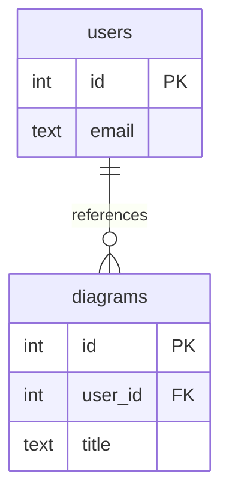

# CTD Studio

[](https://github.com/cxernlol/code-to-diagram/actions/workflows/ci.yml)
[](https://www.npmjs.com/package/ctd-mcp)
[](LICENSE)

Write diagram code, drag it into shape, export. No account, no server.

**[Open the app ->](https://code-to-diagram.vercel.app/)** · **[Syntax & Template Docs ->](https://code-to-diagram.vercel.app/#docs)**

Supports Mermaid, Graphviz DOT, PlantUML, D2, SQL DDL, TypeScript, and XML (Draw.io, BPMN). Your diagrams stay in your browser.


## Features

- **7 input formats**, auto-detected, with one-click conversion between them
- **Multi-select & right-click editing:** Shift+click or box-select group drag, right-click to edit labels, add nodes/classes/entities, arrow-key nudging, grid snap, alignment guides
- **One-click auto-arrange** and orthogonal edge routing
- **Themes:** default, dark, forest, neutral, plus live-previewable colorized boxes across all diagram types on canvas and export
- **Local-first:** diagrams, layouts, and version history live in IndexedDB
- **5-device live rooms:** share a live PeerJS session link to collaborate in real time
- **Export** full-bounds SVG/PNG, or restore/share diagrams with manual layout via `#d=` URLs
- **Optional BYOK AI:** 14 providers (OpenAI, Anthropic, Google Gemini, DeepSeek, OpenRouter, Groq, xAI, Mistral, Together, Fireworks, Ollama, LM Studio, Anthropic-compatible, or custom), model auto-detect, and `low`/`medium`/`high`/`max` usage presets
- **Syntax & template docs:** quick reference for arrows (`-->`, `-.->`, `==>`), shapes, 7-format syntax, and starter templates at [`#docs`](https://code-to-diagram.vercel.app/#docs)

## Supported Syntax

All 7 formats are auto-detected and can be converted to Mermaid or translated across formats via the shared intermediate representation (`src/lib/formats.ts` and `src/lib/translate.ts`). Non-Mermaid formats support focused, practical subsets rather than full language specs:

| Format | Extension | What is parsed & rendered | Notable omissions |
| :--- | :--- | :--- | :--- |
| **Mermaid** | `.mmd` | **Full Mermaid v12.3.0** for rendering. IR translation supports `flowchart`/`graph` (shapes, `TD`/`LR`, `-->`/`-.->`/`==>`/`---`/`<-->`), `classDiagram`, `erDiagram`, and `sequenceDiagram`. | Other Mermaid types (`gantt`, `pie`, `mindmap`, `gitGraph`, `C4*`, etc.) render natively but are not translated by the IR converter. |
| **Graphviz DOT** | `.dot` | `(strict) (di)graph`, `rankdir` (`TB`/`TD`/`BT`/`RL`/`LR`), node `label` & `shape` (`diamond`, `circle`, `doublecircle`, `ellipse`, `oval`, `cylinder`), chained `->` / `--` edges with `label` & `style=dashed\|dotted`, `//` and `/* */` comments. | `subgraph` blocks, default `node`/`edge`/`graph` attribute statements, HTML-like labels, and `record` port layouts. |
| **PlantUML** | `.puml` | `@startuml` blocks: **sequence** (`actor`/`participant`, `->`/`-->`/`->>`/`-->>` messages), **state** (`[*]` & `state` transitions), **activity** (`start`/`stop`, `:Action;`, `if`/`else`/`endif`, `while`/`endwhile`, `repeat`/`repeat while`, `fork`/`end fork`), and **class** (`class`/`interface`/`enum`/`abstract class`, `hide attributes`/`fields`/`methods`/`members`, and `<\|--`, `*--`, `o--`, `-->`, `..>`, `..\|>`, `--` relations). | Component, deployment, and use-case diagrams; `alt`/`loop` fragments, `package` nesting, and `skinparam` styling. |
| **D2** | `.d2` | `direction` (`right`/`left`/`down`/`up`), nested `{ ... }` containers (`subgraph`), `id: label`, `id.shape: <shape>`, edges (`->`, `<-`, `<->`, `--`) with labels, and `#` comments. | `sql_table` / `class` shape blocks, `style` rules, `icon`, `link`, `near`, `grid-*`, and `vars`/`layers`/`scenarios`. |
| **SQL DDL** | `.sql` | `CREATE TABLE [IF NOT EXISTS]` statements into `erDiagram` entities: column names & base types, `PRIMARY KEY` (`PK`), inline `REFERENCES`, table-level `FOREIGN KEY ... REFERENCES`, and `--` / `/* */` comments. | `ALTER TABLE`, views, indexes, `ENUM` declarations, triggers/functions, and `CHECK`/`UNIQUE` constraint details. |
| **TypeScript** | `.ts` | `[export] interface`, `class`, and object `type Name = { ... }` declarations; `extends`/`implements` (`<\|--`), PascalCase property type references (`-->`), properties, methods, and `//` / `/* */` comments. | Generic type parameters (`<T>`), non-object union/intersection `type` aliases, `enum`s, functions, and imports. |
| **XML** | `.xml` | **Draw.io / mxGraph** (`mxCell` vertices & edges), **BPMN 2.0** (`sequenceFlow`, events, gateways, tasks), explicit `<diagram>`/`<graph>`/`<schema>` (`<node>`/`<table>`/`<class>` + `<edge>`/`<relation>`), and **generic XML** as a hierarchical tree. | Draw.io styling/coordinates beyond basic shapes & dashed edges; BPMN pools/lanes/message flows; XML namespaces/XSD validation. |

## Getting Started

```bash
git clone https://github.com/cxernlol/code-to-diagram.git
cd code-to-diagram
npm install
npm run dev
```

Type-check and build for production:

```bash
npm run build
```

Run the Playwright end-to-end test suite:

```bash
npm test
```

## CTD Studio MCP Server (`ctd-mcp` via `npx`)

`ctd-mcp` is the Model Context Protocol (MCP) server ([`mcp/`](mcp/README.md)) bundled with this repo, reusing the same multi-format parsers and translators. Use it in **Claude Desktop**, **Cursor**, **Windsurf**, **VS Code**, **Claude Code**, or directly from your terminal.

Run directly via `npx` (`ctd-mcp` on npm):

```bash
npx -y ctd-mcp
```

### Claude Desktop / Cursor / Windsurf

Add to `claude_desktop_config.json`, `.cursor/mcp.json`, or `mcp_config.json`:

```json
{
  "mcpServers": {
    "ctd-mcp": {
      "command": "npx",
      "args": ["-y", "ctd-mcp"]
    }
  }
}
```

### VS Code (`.vscode/mcp.json`)

```json
{
  "servers": {
    "ctd-mcp": {
      "type": "stdio",
      "command": "npx",
      "args": ["-y", "ctd-mcp"]
    }
  }
}
```

### Available MCP Tools & Resources

- **Tools:** `detect_format`, `to_mermaid`, `translate_format`, `parse_diagram_ir`, `emit_from_ir`, `list_templates`, `get_studio_info`
- **Resources & Prompt:** `ctd://formats`, `ctd://themes`, `ctd://templates/{name}`, `code_to_diagram`
- **MCP Safety:** `ctd-mcp` runs purely in-memory over stdio and **does not use filesystem or network APIs**. As with any text tool, untrusted diagram labels passed to an assistant remain untrusted text.

Example output from `npx -y ctd-mcp` (`to_mermaid` on SQL DDL):



Build and test the MCP server locally:

```bash
npm run mcp:build
npm run mcp:test
```

## Tech Stack & CI/CD

- **Stack:** TypeScript, React 19, CodeMirror 6, D3 (`d3-selection`, `d3-zoom`), PeerJS (5-device live rooms), and **Mermaid v12.3.0** (bundled locally in `public/mermaid.min.js` for offline reliability and consistent SVG DOM selectors when dragging nodes and edges).
- **CI/CD:** GitHub Actions ([`.github/workflows/ci.yml`](.github/workflows/ci.yml)) runs type-checking, web and `ctd-mcp` builds, MCP stdio tests, and Playwright E2E tests on every push and pull request to `main` (see the CI badge above). Releases publish `ctd-mcp` to npm via [`.github/workflows/publish-mcp.yml`](.github/workflows/publish-mcp.yml).

## Data & Privacy

- **Storage:** Diagrams, layouts, and preferences stay in your browser's IndexedDB. Legacy `mstudio2` `localStorage` data is migrated on first load while keeping a recovery copy.
- **AI Requests & Keys:** API keys are stored in your browser only and are never included in share URLs. Prompts, diagram source, and keys are sent directly from your browser to the endpoint you configure.
- **Cost:** CTD Studio is free to run and has no accounts or paid tiers. If you connect a commercial AI API key, provider usage is billed by that provider.

## Contributing

All changes go through Pull Requests. See [CONTRIBUTING.md](CONTRIBUTING.md) for strict scope boundaries, local-first rules, and required checks before opening a PR.

## License

- **Individual & internal use (free forever):** [Elastic License 2.0 (ELv2)](LICENSE)
- **Commercial SaaS, reselling, or white-labeling:** Requires a paid license under [COMMERCIAL-LICENSE-AGREEMENT.md](COMMERCIAL-LICENSE-AGREEMENT.md) (contact `mrshimn@proton.me`).
